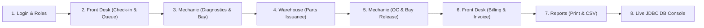

# คู่มือการนำเสนอโครงงานระบบจัดการคิวและออเดอร์อู่ซ่อมรถ
*(Car Repair Queue & Order Management System — Final Presentation Guide)*

เอกสารนี้จัดทำขึ้นเพื่อให้นิสิตใช้ฝึกซ้อมและใช้เป็นคู่มือประกอบการนำเสนอโครงงานวิชา System Analysis (SA) ในวันที่ 7 ตามเกณฑ์การให้คะแนนในไฟล์ `รายละเอียดของคะแนนโครงงาน.xlsx` และ `detailWithExel.txt`

---

## 📌 Checklist ความพร้อมก่อนนำเสนอ (คะแนนข้อกำหนดพื้นฐาน 5 คะแนนเต็ม)

- [ ] **1. สายเชื่อมต่อ Projector**: เตรียมหัวแปลงพอร์ต **HDMI** ของตนเองมาด้วย *(ตามกฎของอาจารย์: หากขอยืมอาจารย์จะถูกหัก 2.5 คะแนนทันที)*
- [ ] **2. ไฟล์สไลด์นำเสนอ**: เซฟไฟล์สไลด์เป็น **PDF** ไว้อย่างน้อย 1 ชุด และตรวจสอบว่ามี **เลขหน้าสไลด์** ครบทุกหน้า
- [ ] **3. การเปิดกล้องและสมาชิกทุกคน**: สมาชิกทุกคนต้องมาพร้อมเพรียงกันในห้องเรียน หากเป็นการนำเสนอออนไลน์ทุกคนต้องออนไลน์และเปิดกล้อง *(หัก 50% หากไม่เปิดกล้อง)*
- [ ] **4. สไลด์หน้าปก**: มีรูปถ่าย, รหัสประจำตัวนิสิต, ชื่อ-นามสกุล ของสมาชิกทุกคนครบถ้วน *(หัก 5 คะแนนหากไม่มี)*
- [ ] **5. การเริ่มนำเสนอด้วยภาษาอังกฤษ**: หัวหน้ากลุ่มหรือตัวแทนเปิดการนำเสนอด้วยภาษาอังกฤษตามบทพูดด้านล่าง

---

## 🎙️ 1. บทพูดเปิดการนำเสนอด้วยภาษาอังกฤษ (English Business Introduction)
*(อาจารย์กำหนดในเกณฑ์ Row 2: "ในการเริ่มนำเสนอให้พูดแนะนำขอบเขตธุรกิจที่เป็นโจทย์ในโครงการนี้ด้วยภาษาอังกฤษ")*

> **"Good morning / afternoon, Professor and everyone.**  
> Today, our team proudly presents the **Car Repair Queue and Order Management System**.  
> In traditional auto repair shops, the primary business bottleneck is inefficient queue dispatching, lack of real-time visibility into repair bays, and delayed inventory synchronization, leading to extended customer wait times and manual accounting errors.  
> 
> To solve these challenges, our application automates the end-to-end business flow: from initial customer check-in and queue ticket issuance, to diagnostic estimation, physical bay scheduling, real-time spare parts requisition with ledger tracking, and final financial settlement.  
> 
> The system is architected with a high-performance **Java 21 Spring Boot backend using 100% direct JDBC** to interact with an 18-table relational database, paired with a modern **Next.js responsive web frontend**.  
> 
> Let us now walk you through the architecture, system models, and a live demonstration of the application."

---

## 🎬 2. ลำดับขั้นตอนการสาธิตโปรแกรมสด (Live Demonstration Script)

ก่อนเริ่มนำเสนอ ให้ดับเบิลคลิกไฟล์ `start_system.bat` รอ 5 วินาที ระบบจะเปิดเบราว์เซอร์ไปที่ `http://localhost:3000` โดยอัตโนมัติ



### ขั้นตอนที่ 1: หน้าจอ Login และการจัดการบทบาท (Site Map / RBAC)
1. เปิดหน้า `http://localhost:3000/login`
2. **จุดอธิบายอาจารย์**: 
   - ระบบมีระบบรักษาความปลอดภัยตามบทบาท (Role-Based Access Control - RBAC) ครอบคลุม 5 แผนกตาม Site Map ที่ออกแบบไว้
   - มี **Quick-Login Role Switcher** ด้านล่างฟอร์ม เพื่อความสะดวกในการสาธิต

### ขั้นตอนที่ 2: งานรับรถและเปิดคิวบริการ (Front Desk: UC01)
1. สลับบทบาทเป็น **Front Desk** (คลิกปุ่ม Front Desk หรือล็อกอินด้วย `frontdesk` / `password123`)
2. ไปที่เมนู **"ลงทะเบียนรับรถ (Check-In)"** (`/front-desk/check-in`)
   - เลือกลูกค้าเดิม หรือกรอกทะเบียนรถ เช่น `1กข-9999`
   - ระบุอาการเบื้องต้น: *"เบรคมีเสียงดัง และต้องการเปลี่ยนถ่ายน้ำมันเครื่อง"*
   - กดปุ่ม **"เปิดคิวบริการ (Generate Queue Ticket)"**
   - ชี้ให้อาจารย์ดู: ระบบจะสร้างบัตรคิว (เช่น `Q-005`) พร้อมประเภทคิว และสถานะเข้าสู่กระดานคิวทันที
3. ไปที่เมนู **"กระดานคิว (Queue Board)"** (`/front-desk/queue`)
   - แสดงบัตรคิวที่กำลังรอรับบริการ จัดลำดับแบบ Anti-starvation FIFO
   - กดปุ่ม **"เรียกคิว (Call Next)"** เพื่อเปลี่ยนสถานะเป็น `CALLED` และเปิดใบสั่งซ่อม (Repair Order: `RO-xxx`)

### ขั้นตอนที่ 3: การตรวจเช็คและจองช่องซ่อม (Mechanic: UC04, UC03, UC02)
1. สลับบทบาทเป็น **Mechanic** (คลิกปุ่ม Quick Switcher -> Mechanic)
2. ไปที่เมนู **"ตรวจเช็คและประเมินราคา (Diagnostics)"** (`/mechanic/diagnostics`)
   - เลือกใบสั่งซ่อมที่เพิ่งเปิด
   - เพิ่มรายการตรวจเช็ค: เบรคหน้า, น้ำมันเครื่องสังเคราะห์
   - บันทึกการประเมินราคา (Estimate) ส่งต่อให้ลูกค้าอนุมัติ
3. ไปที่เมนู **"ช่องซ่อม & QC (Active Bay)"** (`/mechanic/bay`)
   - มอบหมายช่างเข้าช่องซ่อม **Bay 1 (ช่องซ่อมที่ 1)**
   - **จุดเน้นย้ำอาจารย์**: ระบบมี Database Constraint (`uk_ro_single_active_bay`) ป้องกันไม่ให้มีรถเข้าซ่อมซ้ำในช่องเดียวกัน 100%
4. ไปที่เมนู **"ขอเบิกอะไหล่ (Parts Requisitions)"** (`/mechanic/requisitions`)
   - สร้างคำขอเบิกอะไหล่: ผ้าเบรคหน้า (2 ชุด), น้ำมันเครื่อง 5W-30 (1 แกลลอน)
   - สถานะคำขอจะขึ้นเป็น `REQUESTED`

### ขั้นตอนที่ 4: การอนุมัติจ่ายอะไหล่และตัดสต็อก (Warehouse: UC07, UC12, UC14)
1. สลับบทบาทเป็น **Warehouse** (คลิกปุ่ม Quick Switcher -> Warehouse)
2. ไปที่เมนู **"อนุมัติจ่ายและรับคืนอะไหล่ (Parts Issuance)"** (`/warehouse/issuance`)
   - จะเห็นรายการขอเบิกจากช่างในขั้นตอนที่แล้ว
   - กดปุ่ม **"อนุมัติและจ่ายอะไหล่ (Approve & Issue)"**
   - ชี้ให้อาจารย์ดู: ยอด On-Hand จะถูกตัดออกทันที และระบบจะบันทึก Log ลงในตาราง `stock_movement`
3. ไปที่เมนู **"สมุดบัญชีสต็อก (Stock Movement Ledger)"** (`/warehouse/ledger`)
   - ชี้ให้เห็นว่ามีการบันทึกธุรกรรมเป็นประวัติชัดเจน (Type: `ISSUE`, Reference RO ID, ผู้ทำรายการ, วันเวลา)

### ขั้นตอนที่ 5: ตรวจสอบคุณภาพและปล่อยช่องซ่อม (Mechanic: UC03)
1. สลับกลับมาที่ **Mechanic** (`/mechanic/bay`)
2. ตรวจสอบสถานะงานซ่อมเมื่อเสร็จสิ้น
3. กดปุ่ม **"ผ่านการตรวจ QC & ปล่อยช่องซ่อม (Pass QC & Release Bay)"**
   - สถานะใบสั่งซ่อมเปลี่ยนเป็น `COMPLETED`
   - ช่องซ่อม Bay 1 ถูกคืนสถานะว่าง (`AVAILABLE`) เพื่อให้คิวถัดไปเข้าใช้ได้

### ขั้นตอนที่ 6: การปิดงานและออกใบแจ้งหนี้/ใบเสร็จ (Front Desk: UC04, UC05)
1. สลับกลับมาที่ **Front Desk** ไปที่เมนู **"ปิดงานและออกใบเสร็จ (Billing & Invoicing)"** (`/front-desk/billing`)
2. เลือกใบสั่งซ่อมที่เพิ่งเสร็จสิ้น
3. ระบบจะคำนวณ:
   - ค่าแรง (Labor Fee)
   - ค่าอะไหล่ตามจริง (Parts Cost)
   - ภาษีมูลค่าเพิ่ม (VAT 7%)
4. เลือกรูปแบบการชำระเงิน (เงินสด / บัตรเครดิต / โอนเงิน) แล้วกดปุ่ม **"บันทึกรับชำระและออกใบเสร็จ (Settle & Print Invoice)"**
5. แสดงหน้าใบเสร็จรับเงินที่พร้อมพิมพ์ทันที

### ขั้นตอนที่ 7: การออกรายงานเชิงบริหาร 2 รายงาน (Reports)
1. ไปที่เมนู **"รายงานสรุปงานซ่อม (Repair Operations Report)"** (`/reports/repairs`)
   - แสดงตัวเลขสถิติรวม: งานซ่อมทั้งหมด, รายได้ค่าแรง, รายได้ค่าอะไหล่, ยอดขายรวม
   - กดปุ่ม **"Print Official Report"** -> แสดงหน้าจอพิมพ์พร้อมหัวกระดาษทางการและช่องเซ็น 3 ตำแหน่ง
   - กดปุ่ม **"Export CSV"** -> ดาวน์โหลดไฟล์ CSV ไปเปิดบน Excel ภาษาไทยไม่เพี้ยน
2. ไปที่เมนู **"รายงานคลังและสินค้าใกล้หมด (Inventory Report)"** (`/reports/inventory`)
   - แสดงมูลค่าคลังสินค้าคงเหลือรวม
   - แสดงรายการสินค้าที่ต้องสั่งซื้อด่วน (Low Stock Alert)
   - แสดงตาราง Top 5 Consumed Parts

### ขั้นตอนที่ 8: ยืนยันการเชื่อมต่อ Direct JDBC กับ Relational Database (เด็ดสุด!)
*(ตอบโจทย์ข้อกำหนดของอาจารย์ใน `detailWithExel.txt`: "และการเชื่อมต่อกับ db ควรใช้ database connect และแสดงให้เห็นจริงๆว่าโปรแกรมใช้")*

1. เปิดเบราว์เซอร์ไปที่: `http://localhost:8080/h2-console`
2. ใส่ค่าการเชื่อมต่อ:
   - **JDBC URL**: `jdbc:h2:file:./data/garagedb`
   - **User Name**: `sa`
   - **Password**: *(ไม่ต้องใส่)*
   - กดปุ่ม **Connect**
3. รันคำสั่ง SQL สดๆ ให้นิสิตและอาจารย์เห็น:
   ```sql
   -- 1. ดูรายการใบสั่งซ่อมล่าสุดที่เพิ่งทำรายการผ่านหน้าเว็บ
   SELECT ro_no, plate_number, status, total_amount, created_at 
   FROM repair_order 
   ORDER BY ro_id DESC LIMIT 5;

   -- 2. ดูการตัดสต็อกที่บันทึกผ่าน JDBC Ledger
   SELECT movement_id, part_id, movement_type, quantity, balance_after, created_at 
   FROM stock_movement 
   ORDER BY movement_id DESC LIMIT 5;

   -- 3. ตรวจสอบใบแจ้งหนี้ที่ออกผ่านระบบ
   SELECT invoice_no, total_amount, payment_method, payment_status 
   FROM invoice 
   ORDER BY invoice_id DESC LIMIT 5;
   ```
4. **สรุปประเด็นกับอาจารย์**:  
   *"ระบบเชื่อมต่อกับ Relational Database ผ่าน Pure Direct JDBC (`NamedParameterJdbcTemplate`) โดยไม่มีการซ่อนเร้นหรือใช้ ORM Framework ใดๆ การทำรายการทุกอย่างบนหน้า Next.js Frontend ส่งคำขอผ่าน REST API ลงมายัง JDBC Repositories และบันทึกลง Table จริงทันทีแบบ Real-time"*

---

## 💡 แนวทางการตอบคำถามอาจารย์ (Q&A Preparation)

**คำถามที่ 1: ทำไมกลุ่มเราถึงเลือกใช้ Direct JDBC แทนที่จะใช้ Hibernate หรือ JPA?**
> **คำตอบ**:  
> "เพื่อให้โปรแกรมมีความโปร่งใส ประสิทธิภาพสูง และสอดคล้องกับหัวข้อการเรียนรู้การวิเคราะห์และออกแบบฐานข้อมูลเชิงสัมพันธ์อย่างแท้จริง การเขียน SQL Query ผ่าน `NamedParameterJdbcTemplate` ทำให้เราสามารถควบคุม Query execution plan, จัดการ Locking (`SELECT ... FOR UPDATE`), ควบคุม Transaction boundaries และตรวจสอบความถูกต้องของ Foreign Keys กับ Invariants ได้อย่างแม่นยำ 100% ครับ"

**คำถามที่ 2: ระบบจัดการปัญหาการจองช่องซ่อมชนกัน (Race Condition / Double Booking) อย่างไร?**
> **คำตอบ**:  
> "เราป้องกันถึง 2 ระดับครับ  
> ระดับที่ 1 คือ Service Layer จะตรวจสอบสถานะ `is_occupied` ของช่องซ่อม  
> ระดับที่ 2 คือในระดับ Relational Database Schema เราได้สร้าง Generated Column และใส่ Database Unique Constraint `uk_ro_single_active_bay` กำกับไว้ หากมีข้อผิดพลาดหรือเกิด concurrent request พร้อมกัน ฐานข้อมูลจะ Reject คำสั่งที่สองทันที ทำให้ไม่มีทางเกิดปัญหารถสองคันเข้าซ่อมช่องเดียวกันครับ"

**คำถามที่ 3: ระบบตัดสต็อกอะไหล่อย่างไร ป้องกันยอดสต็อกติดลบได้อย่างไร?**
> **คำตอบ**:  
> "เราใช้หลักการ Double-Entry Stock Movement Ledger ควบคู่กับ CHECK Constraint ใน Database ครับ โดยในตาราง `part` มีคอลัมน์ `on_hand` และ `reserved` ซึ่งมี Constraint `CHECK (on_hand >= 0)` กำกับไว้ และทุกครั้งที่มีการเบิกจ่ายหรือรับเข้า จะต้องมีการ Insert บันทึกลงตาราง `stock_movement` เสมอ ทำให้ตรวจสอบย้อนหลัง (Audit Trail) ได้ทุกขั้นตอนครับ"
